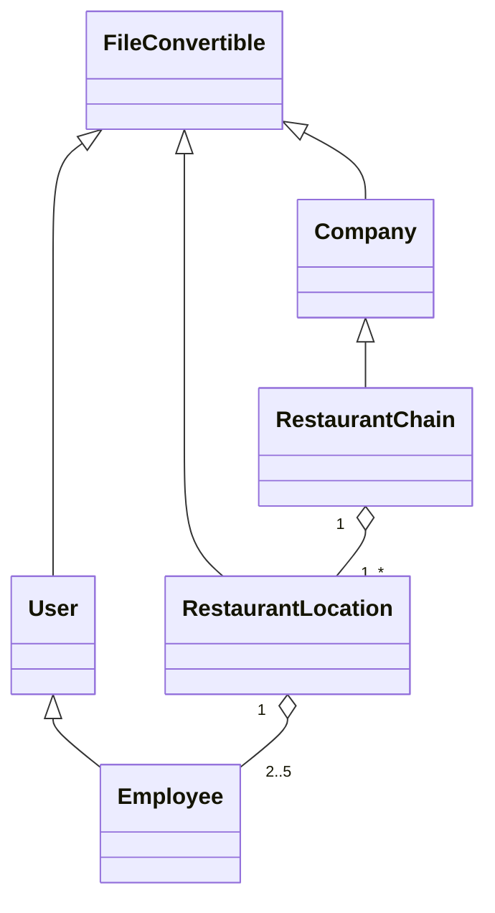
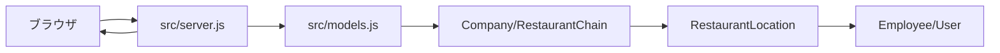

# 01 ARCHITECTURE — 構造と設計意図

```text
Restaurant-Chain-Mockup/
├── src/models.js       モデル、表示用変換、モック生成
├── src/server.js       HTTP受付、ページ合成、ルーティング
├── tests/models.test.js 変換・継承・HTTPの検証
├── docs/               仕様判断・検証記録
└── learning/           学習教材
```

## クラス図



`RestaurantChain`は会社でもあり、複数の店舗を所有する。`Employee`はユーザーとしての基本属性を継承する。`RestaurantLocation`には従業員の配列を持たせる。継承（is-a）と包含（has-a）を使い分けた。

## モジュール依存



モデルはHTTPを知らず、サーバーはモデルを利用するだけ。これにより、モデルをHTTP以外の用途、例えばテストやMarkdown出力にも流用できる。

## 設計理由

- **共通の変換契約**：全クラスが同じ3つのメソッドを持ち、画面とテキストの両方を作れる。
- **独立した乱数生成**：各クラスの`randomGenerator`がそのクラスのサンプルを返すため、テストデータの作成を簡単にする。
- **外部依存なし**：標準の`node:http`だけを使うので、セットアップや提出時の依存解決がない。
- **開閉UI**：`details`/`summary`はJavaScriptクライアントコードなしで動作するブラウザ標準機能。

## 制約

この課題はモック。永続化、ログイン、APIキー、実業務用の給与/個人情報の取り扱いは実装対象外。
